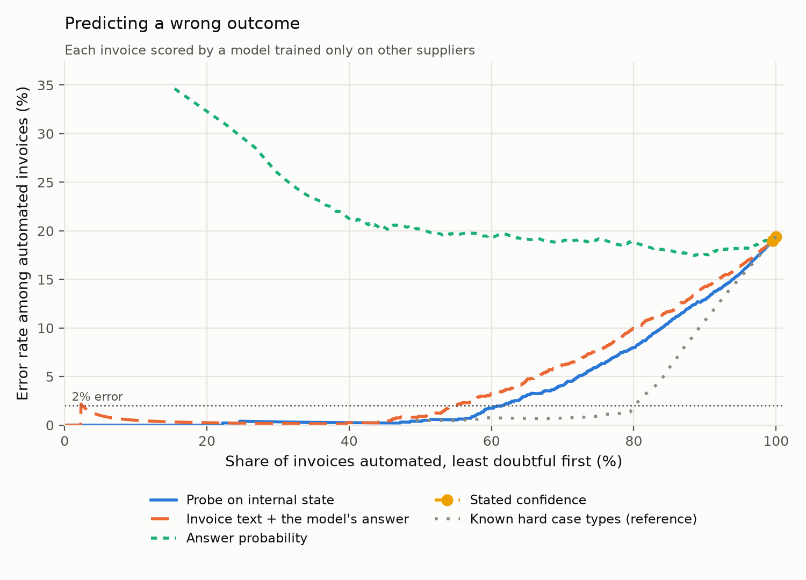
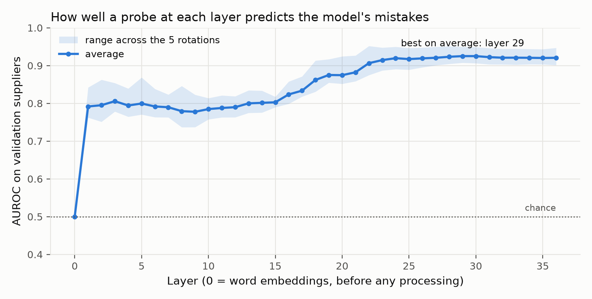

# The Tell

**Can you tell from inside a language model that it is about to get it wrong?**

In poker, a *tell* is an involuntary signal that gives away what a player is about to do.
This project looks for a language model's tell: a signal in its internal state, read
before it answers, that predicts when its answer will be wrong. And it asks whether that
signal is a better guide to "when should a human check this?" than the model's own
stated confidence.

The test bed is accounts payable: reviewing supplier invoices against purchase orders,
deliveries, credit notes and a written policy, and deciding whether to approve or hold
each one, and why.

## Status

| Step | What | State |
|---|---|---|
| 1 | Synthetic invoice generator with labels known by construction | Done |
| 2 | Deterministic pre-checks and the prompt | Done |
| 3 | Open-model run: answers and internal activations, 2,000 invoices | Done |
| 4 | Probes vs baselines, risk-coverage chart | First results below |
| 5 | Same test on Claude (output-based signals only) | |
| 6 | Write-ups: one for engineers, one for a finance director | |

## Run it

```bash
uv sync
uv run pytest                                   # 31 tests
uv run python -m the_tell.generate --n 2000     # writes data/generated/cases.jsonl
uv run python -m the_tell.review_sample         # writes data/review_sample.md
uv run python -m the_tell.prompt                # writes data/prompt_examples.md

# Step 3: run the local model (downloads ~8 GB once; about 4 s per invoice on an M4 Pro)
uv run python -m the_tell.run_local --run qwen3-4b-full
uv run python -m the_tell.viewer --run qwen3-4b-full   # watch it live at http://127.0.0.1:8765

# Step 4: which signal predicts the mistakes? (tables, then charts in results/)
uv run python -m the_tell.analysis --run qwen3-4b-full
uv run python -m the_tell.analysis --run qwen3-4b-full --held-out TAX_ERROR
uv run python -m the_tell.charts --run qwen3-4b-full
```

## First results (step 4, local model)

Model: Qwen3-4B-Instruct-2507, run locally. 2,000 invoices from 40 suppliers. The model
got 388 wrong (19%), and wrote "confidence 100" on every single answer, right or wrong.

Every score below was produced by a model that never saw the invoice's supplier: the 40
suppliers are split into five groups, and each group is scored by a probe trained on the
others. Ranges are 95% ranges from resampling suppliers 1,000 times. Full tables are in
`results/report.txt`.



The same numbers as a table. AUROC is how well a signal ranks wrong answers above right
ones: 0.5 is a coin toss, 1.0 is perfect. "Automatable" is the largest share of invoices
that could be left to the model, least doubtful first, with at most 2% of those wrong.

| Signal | AUROC | Automatable at 2% error |
|---|---|---|
| Model's stated confidence | 0.51 (0.51 to 0.52) | 0% |
| Model's probability for its answer | 0.47 (0.44 to 0.51) | 0% |
| Which answer the model gave | 0.72 (0.69 to 0.74) | 35% (32% to 38%) |
| Invoice text only | 0.82 (0.80 to 0.84) | 28% (10% to 40%) |
| Invoice text + the model's answer | 0.89 (0.87 to 0.90) | 55% (50% to 61%) |
| **Probe on internal state** | **0.92 (0.90 to 0.93)** | **61% (57% to 66%)** |
| Known hard case types (reference only, not available in real life) | 0.98 (0.97 to 0.99) | 79% (77% to 82%) |

Scoring only the approve-or-hold decision (a wrong reason for holding counts as right)
gives nearly identical results: probe 0.92, 62% automatable.

What this shows so far:

1. **The model's own confidence is useless here.** Its stated confidence and its
   probability for its answer are no better than a coin toss at spotting its mistakes.
2. **A probe on its internal state is far better**, and beats every cheap baseline,
   including one that reads the invoice text together with the model's answer. But its
   lead over that strongest baseline is small: +0.03 AUROC (0.02 to 0.05).
3. **Much of what the probe reads is the answer the model is about to give**, plus the
   kind of invoice. The layer chart shows it: one layer in, the probe already scores
   about 0.8 (about what the invoice text alone gets); it climbs to about 0.92 from layer
   22, where the answer forms.
4. **Where the probe clearly beats text and answer** is on false alarms about price.
   Among invoices the model held for a price variance, the probe separates right from
   wrong at 0.89, the text-and-answer baseline at 0.55.
5. **It does not carry over to a new kind of mistake.** Trained without any tax errors,
   the probe ranks the model's tax mistakes as its safest answers (AUROC 0.02). In
   training, most mistakes were false alarms, so it learned "approving is safe"; on tax
   errors the mistakes are wrongful approvals. Every signal that knows the answer fails
   the same way. A mistake-predictor learns the mistakes it has seen.



Layer 0 scores exactly 0.5 because the probe reads the last word of the prompt, which
is the same for every invoice before any processing.

## How the data works

Every case starts as a clean purchase order, delivery and invoice that all match. A
scenario then introduces exactly one problem, or leaves the invoice correct but tricky
(an agreed price rise, a second partial delivery, a supplier trading name). Because the
problem is put there on purpose, the right answer is known without anyone labelling it.

An independent **oracle** re-derives each label from the policy rules, and generation
stops if the two ever disagree. That proves the generator is consistent with one reading
of the policy. It does not prove the policy is unambiguous, so a human reviews a sample
against the exact rule that decides each case (`data/review_sample.md`).

All data is synthetic. No real invoices, suppliers or people.
